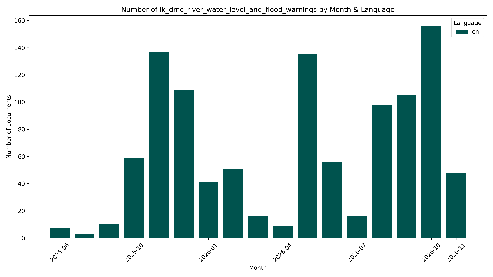

# 💧#SriLanka 🇱🇰 Dmc River Water Level And Flood Warnings `Dataset`


[https://github.com/nuuuwan/lk_dmc/tree/data_lk_dmc_river_water_level_and_flood_warnings/data/lk_dmc_river_water_level_and_flood_warnings](https://github.com/nuuuwan/lk_dmc/tree/data_lk_dmc_river_water_level_and_flood_warnings/data/lk_dmc_river_water_level_and_flood_warnings)

River Water Level and Flood Warnings for various places in Sri Lanka.

- [**1,056** documents](https://github.com/nuuuwan/lk_dmc/tree/data_lk_dmc_river_water_level_and_flood_warnings/data/lk_dmc_river_water_level_and_flood_warnings) (**393.5 MB**), from **2025-06-10** to **2026-11-10**, scraped from [https://www.dmc.gov.lk](https://www.dmc.gov.lk)

- In **JSON**, **PDF**, **TXT** & **🤗 Hugging Face**

- In **English**

- 🎓 Cite as **[arXiv:2510.04124](https://arxiv.org/abs/2510.04124) [cs.CL]**

## 📝 Example Metadata

```json
{
    "doc_type": "lk_dmc_river_water_level_and_flood_warnings",
    "doc_id": "2026-11-10-00-30-water-level",
    "num": "00-30-water-level",
    "date_str": "2026-11-10",
    "description": "water level",
    "url_metadata": "https://www.dmc.gov.lk/index.php?option=com_dmcreports&view=reports&Itemid=277&report_type_id=6&lang=en&limitstart=0",
    "lang": "en",
    "url_pdf": "https://www.dmc.gov.lk/images/dmcreports/Water_level_&_Rainfall_2026__1794251657.pdf",
    "time_str": "00:30",
    "ut": 1794250800.0
}
```



## 🤗 Hugging Face Datasets


- [nuuuwan/lk-dmc-river-water-level-and-flood-warnings-docs](https://huggingface.co/datasets/nuuuwan/lk-dmc-river-water-level-and-flood-warnings-docs)
- [nuuuwan/lk-dmc-river-water-level-and-flood-warnings-chunks](https://huggingface.co/datasets/nuuuwan/lk-dmc-river-water-level-and-flood-warnings-chunks)

## 🆕 20 Latest documents

- 2026-11-10 | `00-30-water-level` | water level | [data](https://github.com/nuuuwan/lk_dmc/tree/data_lk_dmc_river_water_level_and_flood_warnings/data/lk_dmc_river_water_level_and_flood_warnings/2020s/2026/2026-11-10-00-30-water-level)
- 2026-11-09 | `21-30-water-level` | water level | [data](https://github.com/nuuuwan/lk_dmc/tree/data_lk_dmc_river_water_level_and_flood_warnings/data/lk_dmc_river_water_level_and_flood_warnings/2020s/2026/2026-11-09-21-30-water-level)
- 2026-11-09 | `20-00-flood-warning-for-gin-river-basin` | Flood Warning for Gin River Basin | [data](https://github.com/nuuuwan/lk_dmc/tree/data_lk_dmc_river_water_level_and_flood_warnings/data/lk_dmc_river_water_level_and_flood_warnings/2020s/2026/2026-11-09-20-00-flood-warning-for-fc53c382)
- 2026-11-09 | `18-30-water-level` | Water level | [data](https://github.com/nuuuwan/lk_dmc/tree/data_lk_dmc_river_water_level_and_flood_warnings/data/lk_dmc_river_water_level_and_flood_warnings/2020s/2026/2026-11-09-18-30-water-level)
- 2026-11-09 | `15-00-water-level` | Water level | [data](https://github.com/nuuuwan/lk_dmc/tree/data_lk_dmc_river_water_level_and_flood_warnings/data/lk_dmc_river_water_level_and_flood_warnings/2020s/2026/2026-11-09-15-00-water-level)
- 2026-11-09 | `12-30-water-level--rainfall` | Water level & Rainfall | [data](https://github.com/nuuuwan/lk_dmc/tree/data_lk_dmc_river_water_level_and_flood_warnings/data/lk_dmc_river_water_level_and_flood_warnings/2020s/2026/2026-11-09-12-30-water-level--rainfall)
- 2026-11-09 | `12-30-flood-warning-for-attanagalu-oya--no-01` | Flood Warning for Attanagalu Oya - NO 01 | [data](https://github.com/nuuuwan/lk_dmc/tree/data_lk_dmc_river_water_level_and_flood_warnings/data/lk_dmc_river_water_level_and_flood_warnings/2020s/2026/2026-11-09-12-30-flood-warning-for-3cf9220b)
- 2026-11-09 | `09-30-water-level` | Water level | [data](https://github.com/nuuuwan/lk_dmc/tree/data_lk_dmc_river_water_level_and_flood_warnings/data/lk_dmc_river_water_level_and_flood_warnings/2020s/2026/2026-11-09-09-30-water-level)
- 2026-11-09 | `06-30-water-level` | Water Level | [data](https://github.com/nuuuwan/lk_dmc/tree/data_lk_dmc_river_water_level_and_flood_warnings/data/lk_dmc_river_water_level_and_flood_warnings/2020s/2026/2026-11-09-06-30-water-level)
- 2026-11-09 | `00-30-water-level` | Water Level | [data](https://github.com/nuuuwan/lk_dmc/tree/data_lk_dmc_river_water_level_and_flood_warnings/data/lk_dmc_river_water_level_and_flood_warnings/2020s/2026/2026-11-09-00-30-water-level)
- 2026-11-08 | `18-30-water-level-report-at-1830hrs` | Water Level Report at 1830hrs | [data](https://github.com/nuuuwan/lk_dmc/tree/data_lk_dmc_river_water_level_and_flood_warnings/data/lk_dmc_river_water_level_and_flood_warnings/2020s/2026/2026-11-08-18-30-water-level-repor-9894a033)
- 2026-11-08 | `12-30-water-level--rainfall` | Water level & Rainfall | [data](https://github.com/nuuuwan/lk_dmc/tree/data_lk_dmc_river_water_level_and_flood_warnings/data/lk_dmc_river_water_level_and_flood_warnings/2020s/2026/2026-11-08-12-30-water-level--rainfall)
- 2026-11-08 | `09-30-water-level--rainfall` | Water level & Rainfall | [data](https://github.com/nuuuwan/lk_dmc/tree/data_lk_dmc_river_water_level_and_flood_warnings/data/lk_dmc_river_water_level_and_flood_warnings/2020s/2026/2026-11-08-09-30-water-level--rainfall)
- 2026-11-08 | `06-30-water-level-report-at-0630hrs` | Water Level report at 0630hrs | [data](https://github.com/nuuuwan/lk_dmc/tree/data_lk_dmc_river_water_level_and_flood_warnings/data/lk_dmc_river_water_level_and_flood_warnings/2020s/2026/2026-11-08-06-30-water-level-repor-b44e0d28)
- 2026-11-08 | `00-30-water-level` | Water Level | [data](https://github.com/nuuuwan/lk_dmc/tree/data_lk_dmc_river_water_level_and_flood_warnings/data/lk_dmc_river_water_level_and_flood_warnings/2020s/2026/2026-11-08-00-30-water-level)
- 2026-11-07 | `18-30-water-level-report` | Water Level Report | [data](https://github.com/nuuuwan/lk_dmc/tree/data_lk_dmc_river_water_level_and_flood_warnings/data/lk_dmc_river_water_level_and_flood_warnings/2020s/2026/2026-11-07-18-30-water-level-report)
- 2026-11-07 | `12-30-water-level--rainfall` | Water level & Rainfall | [data](https://github.com/nuuuwan/lk_dmc/tree/data_lk_dmc_river_water_level_and_flood_warnings/data/lk_dmc_river_water_level_and_flood_warnings/2020s/2026/2026-11-07-12-30-water-level--rainfall)
- 2026-11-07 | `09-30-water-level--rainfall` | Water level & Rainfall | [data](https://github.com/nuuuwan/lk_dmc/tree/data_lk_dmc_river_water_level_and_flood_warnings/data/lk_dmc_river_water_level_and_flood_warnings/2020s/2026/2026-11-07-09-30-water-level--rainfall)
- 2026-11-07 | `06-30-water-level--rainfall` | Water level & Rainfall | [data](https://github.com/nuuuwan/lk_dmc/tree/data_lk_dmc_river_water_level_and_flood_warnings/data/lk_dmc_river_water_level_and_flood_warnings/2020s/2026/2026-11-07-06-30-water-level--rainfall)
- 2026-11-07 | `00-30-water-level` | water level | [data](https://github.com/nuuuwan/lk_dmc/tree/data_lk_dmc_river_water_level_and_flood_warnings/data/lk_dmc_river_water_level_and_flood_warnings/2020s/2026/2026-11-07-00-30-water-level)

---

### [More Datasets about 🇱🇰 #SriLanka](https://github.com/nuuuwan/lk_datasets)


[](https://opensource.org/licenses/MIT)
