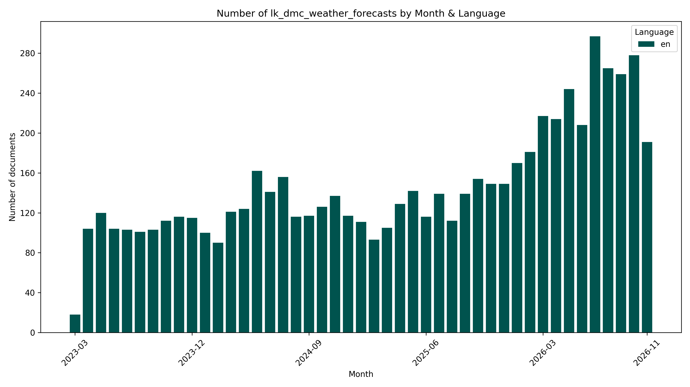

# ☔️#SriLanka 🇱🇰 Dmc Weather Forecasts `Dataset`


[https://github.com/nuuuwan/lk_dmc/tree/data_lk_dmc_weather_forecasts/data/lk_dmc_weather_forecasts](https://github.com/nuuuwan/lk_dmc/tree/data_lk_dmc_weather_forecasts/data/lk_dmc_weather_forecasts)

Weather Forecasts for various places in Sri Lanka.

- [**6,498** documents](https://github.com/nuuuwan/lk_dmc/tree/data_lk_dmc_weather_forecasts/data/lk_dmc_weather_forecasts) (**8.0 GB**), from **2023-03-26** to **2026-11-17**, scraped from [https://www.dmc.gov.lk](https://www.dmc.gov.lk)

- In **JSON**, **PDF**, **TXT**, **Tables** (0%) & **🤗 Hugging Face**

- In **English**

- 🎓 Cite as **[arXiv:2510.04124](https://arxiv.org/abs/2510.04124) [cs.CL]**

## 📝 Example Metadata

```json
{
    "doc_type": "lk_dmc_weather_forecasts",
    "doc_id": "2026-11-17-23-00-warning-for-stron-fd0b2fe3",
    "num": "23-00-warning-for-strong-winds-and-rough-sea",
    "date_str": "2026-11-17",
    "description": "Warning for Strong winds and Rough Sea",
    "url_metadata": "https://www.dmc.gov.lk/index.php?option=com_dmcreports&view=reports&Itemid=274&report_type_id=2&lang=si-ta-en&limitstart=0",
    "lang": "en",
    "url_pdf": "https://www.dmc.gov.lk/images/dmcreports/WARNING_FOR_STRONG_WINDS__1794942693.pdf",
    "time_str": "23:00",
    "ut": 1794936600.0
}
```



## 🤗 Hugging Face Datasets


- [nuuuwan/lk-dmc-weather-forecasts-docs](https://huggingface.co/datasets/nuuuwan/lk-dmc-weather-forecasts-docs)
- [nuuuwan/lk-dmc-weather-forecasts-chunks](https://huggingface.co/datasets/nuuuwan/lk-dmc-weather-forecasts-chunks)

## 🆕 20 Latest documents

- 2026-11-17 | `23-00-warning-for-strong-winds-and-rough-sea` | Warning for Strong winds and Rough Sea | [data](https://github.com/nuuuwan/lk_dmc/tree/data_lk_dmc_weather_forecasts/data/lk_dmc_weather_forecasts/2020s/2026/2026-11-17-23-00-warning-for-stron-fd0b2fe3)
- 2026-11-17 | `23-00-the-warning-for-strong-winds-and-rough-seas-akvan` | The Warning for strong winds and rough seas (Akvan) | [data](https://github.com/nuuuwan/lk_dmc/tree/data_lk_dmc_weather_forecasts/data/lk_dmc_weather_forecasts/2020s/2026/2026-11-17-23-00-the-warning-for-s-8d868e14)
- 2026-11-17 | `16-00-weather-forecast-tamil-language` | Weather Forecast (Tamil Language) | [data](https://github.com/nuuuwan/lk_dmc/tree/data_lk_dmc_weather_forecasts/data/lk_dmc_weather_forecasts/2020s/2026/2026-11-17-16-00-weather-forecast--2c3f4dc6)
- 2026-11-17 | `16-00-weather-forecast` | Weather Forecast | [data](https://github.com/nuuuwan/lk_dmc/tree/data_lk_dmc_weather_forecasts/data/lk_dmc_weather_forecasts/2020s/2026/2026-11-17-16-00-weather-forecast)
- 2026-11-17 | `15-00-weather-forecast-tamil-language` | Weather Forecast (Tamil Language) | [data](https://github.com/nuuuwan/lk_dmc/tree/data_lk_dmc_weather_forecasts/data/lk_dmc_weather_forecasts/2020s/2026/2026-11-17-15-00-weather-forecast--25b7ee17)
- 2026-11-17 | `14-00-weather-forecast` | Weather Forecast | [data](https://github.com/nuuuwan/lk_dmc/tree/data_lk_dmc_weather_forecasts/data/lk_dmc_weather_forecasts/2020s/2026/2026-11-17-14-00-weather-forecast)
- 2026-11-17 | `05-30-weather-report` | Weather Report | [data](https://github.com/nuuuwan/lk_dmc/tree/data_lk_dmc_weather_forecasts/data/lk_dmc_weather_forecasts/2020s/2026/2026-11-17-05-30-weather-report)
- 2026-11-16 | `16-00-weather-report` | Weather Report | [data](https://github.com/nuuuwan/lk_dmc/tree/data_lk_dmc_weather_forecasts/data/lk_dmc_weather_forecasts/2020s/2026/2026-11-16-16-00-weather-report)
- 2026-11-16 | `16-00-weather-forecast-tamil-language` | Weather Forecast (Tamil Language) | [data](https://github.com/nuuuwan/lk_dmc/tree/data_lk_dmc_weather_forecasts/data/lk_dmc_weather_forecasts/2020s/2026/2026-11-16-16-00-weather-forecast--2c3f4dc6)
- 2026-11-16 | `14-00-weather-forecast` | Weather Forecast | [data](https://github.com/nuuuwan/lk_dmc/tree/data_lk_dmc_weather_forecasts/data/lk_dmc_weather_forecasts/2020s/2026/2026-11-16-14-00-weather-forecast)
- 2026-11-16 | `07-00-warning-for-strong-winds-and-rough-seas-tamil-language` | Warning for strong winds and rough seas (Tamil Language) | [data](https://github.com/nuuuwan/lk_dmc/tree/data_lk_dmc_weather_forecasts/data/lk_dmc_weather_forecasts/2020s/2026/2026-11-16-07-00-warning-for-stron-db204b21)
- 2026-11-16 | `07-00-warning-for-strong-winds-and-rough-seas` | Warning for strong winds and rough seas | [data](https://github.com/nuuuwan/lk_dmc/tree/data_lk_dmc_weather_forecasts/data/lk_dmc_weather_forecasts/2020s/2026/2026-11-16-07-00-warning-for-stron-1bedf6d1)
- 2026-11-16 | `05-30-weather-report` | Weather Report | [data](https://github.com/nuuuwan/lk_dmc/tree/data_lk_dmc_weather_forecasts/data/lk_dmc_weather_forecasts/2020s/2026/2026-11-16-05-30-weather-report)
- 2026-11-15 | `16-00-weather-forecast-tamil-language` | Weather Forecast (Tamil Language) | [data](https://github.com/nuuuwan/lk_dmc/tree/data_lk_dmc_weather_forecasts/data/lk_dmc_weather_forecasts/2020s/2026/2026-11-15-16-00-weather-forecast--2c3f4dc6)
- 2026-11-15 | `16-00-weather-forecast` | Weather Forecast | [data](https://github.com/nuuuwan/lk_dmc/tree/data_lk_dmc_weather_forecasts/data/lk_dmc_weather_forecasts/2020s/2026/2026-11-15-16-00-weather-forecast)
- 2026-11-15 | `14-00-weather-forecast` | Weather Forecast | [data](https://github.com/nuuuwan/lk_dmc/tree/data_lk_dmc_weather_forecasts/data/lk_dmc_weather_forecasts/2020s/2026/2026-11-15-14-00-weather-forecast)
- 2026-11-15 | `11-30-warning-for-strong-winds-and-rough-seas` | Warning for strong winds and rough seas | [data](https://github.com/nuuuwan/lk_dmc/tree/data_lk_dmc_weather_forecasts/data/lk_dmc_weather_forecasts/2020s/2026/2026-11-15-11-30-warning-for-stron-67f51b9c)
- 2026-11-15 | `07-30-weather--tamil-language` | Weather ෆදරැජ්ිඑ (Tamil Language) | [data](https://github.com/nuuuwan/lk_dmc/tree/data_lk_dmc_weather_forecasts/data/lk_dmc_weather_forecasts/2020s/2026/2026-11-15-07-30-weather--tamil-language)
- 2026-11-15 | `05-30-weather-report` | Weather Report | [data](https://github.com/nuuuwan/lk_dmc/tree/data_lk_dmc_weather_forecasts/data/lk_dmc_weather_forecasts/2020s/2026/2026-11-15-05-30-weather-report)
- 2026-11-14 | `17-00-weather-report` | Weather Report | [data](https://github.com/nuuuwan/lk_dmc/tree/data_lk_dmc_weather_forecasts/data/lk_dmc_weather_forecasts/2020s/2026/2026-11-14-17-00-weather-report)

---

### [More Datasets about 🇱🇰 #SriLanka](https://github.com/nuuuwan/lk_datasets)


[](https://opensource.org/licenses/MIT)
