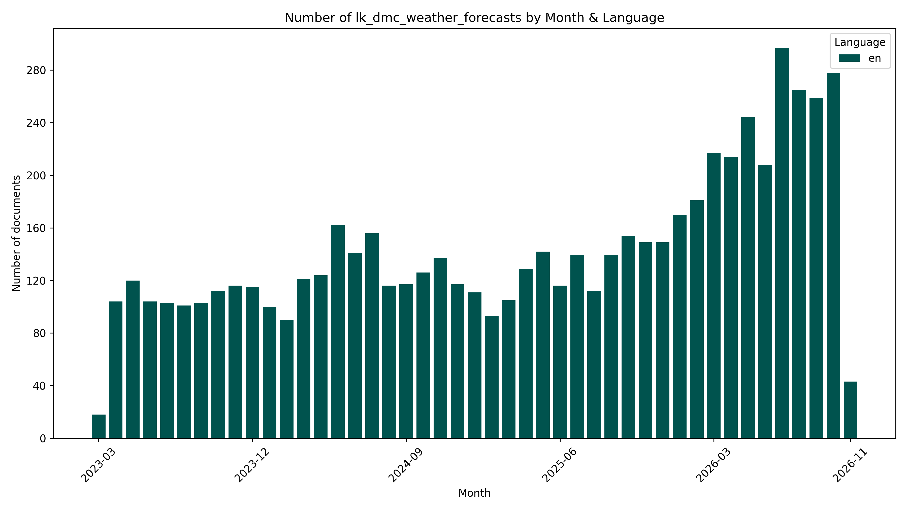

# ☔️#SriLanka 🇱🇰 Dmc Weather Forecasts `Dataset`


[https://github.com/nuuuwan/lk_dmc/tree/data_lk_dmc_weather_forecasts/data/lk_dmc_weather_forecasts](https://github.com/nuuuwan/lk_dmc/tree/data_lk_dmc_weather_forecasts/data/lk_dmc_weather_forecasts)

Weather Forecasts for various places in Sri Lanka.

- [**6,417** documents](https://github.com/nuuuwan/lk_dmc/tree/data_lk_dmc_weather_forecasts/data/lk_dmc_weather_forecasts) (**7.9 GB**), from **2023-03-26** to **2026-11-06**, scraped from [https://www.dmc.gov.lk](https://www.dmc.gov.lk)

- In **JSON**, **PDF**, **TXT**, **Tables** (0%) & **🤗 Hugging Face**

- In **English**

- 🎓 Cite as **[arXiv:2510.04124](https://arxiv.org/abs/2510.04124) [cs.CL]**

## 📝 Example Metadata

```json
{
    "doc_type": "lk_dmc_weather_forecasts",
    "doc_id": "2026-11-06-05-30-weather-forecast--29b99163",
    "num": "05-30-weather-forecast-at-0530hrs",
    "date_str": "2026-11-06",
    "description": "Weather forecast at 0530hrs",
    "url_metadata": "https://www.dmc.gov.lk/index.php?option=com_dmcreports&view=reports&Itemid=274&report_type_id=2&lang=si-ta-en&limitstart=0",
    "lang": "en",
    "url_pdf": "https://www.dmc.gov.lk/images/dmcreports/Weather_forecast_at_0530hrs__1793925585.pdf",
    "time_str": "05:30",
    "ut": 1793923200.0
}
```



## 🤗 Hugging Face Datasets


- [nuuuwan/lk-dmc-weather-forecasts-docs](https://huggingface.co/datasets/nuuuwan/lk-dmc-weather-forecasts-docs)
- [nuuuwan/lk-dmc-weather-forecasts-chunks](https://huggingface.co/datasets/nuuuwan/lk-dmc-weather-forecasts-chunks)

## 🆕 20 Latest documents

- 2026-11-06 | `05-30-weather-forecast-at-0530hrs` | Weather forecast at 0530hrs | [data](https://github.com/nuuuwan/lk_dmc/tree/data_lk_dmc_weather_forecasts/data/lk_dmc_weather_forecasts/2020s/2026/2026-11-06-05-30-weather-forecast--29b99163)
- 2026-11-05 | `16-00-weather-forecast` | Weather Forecast | [data](https://github.com/nuuuwan/lk_dmc/tree/data_lk_dmc_weather_forecasts/data/lk_dmc_weather_forecasts/2020s/2026/2026-11-05-16-00-weather-forecast)
- 2026-11-05 | `14-00-weather-forecast-tamil-language` | Weather Forecast (Tamil Language) | [data](https://github.com/nuuuwan/lk_dmc/tree/data_lk_dmc_weather_forecasts/data/lk_dmc_weather_forecasts/2020s/2026/2026-11-05-14-00-weather-forecast--eb2ff5a1)
- 2026-11-05 | `14-00-weather-forecast-at-1400hrs` | Weather forecast at 1400hrs | [data](https://github.com/nuuuwan/lk_dmc/tree/data_lk_dmc_weather_forecasts/data/lk_dmc_weather_forecasts/2020s/2026/2026-11-05-14-00-weather-forecast--582c1537)
- 2026-11-05 | `13-00-advisory-for-severe-lightning` | Advisory for Severe Lightning | [data](https://github.com/nuuuwan/lk_dmc/tree/data_lk_dmc_weather_forecasts/data/lk_dmc_weather_forecasts/2020s/2026/2026-11-05-13-00-advisory-for-seve-9a640245)
- 2026-11-05 | `06-00-weather-report-tamil-language` | Weather Report (Tamil language) | [data](https://github.com/nuuuwan/lk_dmc/tree/data_lk_dmc_weather_forecasts/data/lk_dmc_weather_forecasts/2020s/2026/2026-11-05-06-00-weather-report-ta-c4c021bd)
- 2026-11-05 | `05-30-weather-report` | Weather Report | [data](https://github.com/nuuuwan/lk_dmc/tree/data_lk_dmc_weather_forecasts/data/lk_dmc_weather_forecasts/2020s/2026/2026-11-05-05-30-weather-report)
- 2026-11-04 | `16-00-weather-report-tamil-language` | Weather Report (Tamil Language) | [data](https://github.com/nuuuwan/lk_dmc/tree/data_lk_dmc_weather_forecasts/data/lk_dmc_weather_forecasts/2020s/2026/2026-11-04-16-00-weather-report-ta-1659a6d1)
- 2026-11-04 | `16-00-weather-forecast` | Weather Forecast | [data](https://github.com/nuuuwan/lk_dmc/tree/data_lk_dmc_weather_forecasts/data/lk_dmc_weather_forecasts/2020s/2026/2026-11-04-16-00-weather-forecast)
- 2026-11-04 | `14-30-weather-forecast-tamil` | Weather Forecast (Tamil) | [data](https://github.com/nuuuwan/lk_dmc/tree/data_lk_dmc_weather_forecasts/data/lk_dmc_weather_forecasts/2020s/2026/2026-11-04-14-30-weather-forecast-tamil)
- 2026-11-04 | `14-00-weather-forecast` | Weather Forecast | [data](https://github.com/nuuuwan/lk_dmc/tree/data_lk_dmc_weather_forecasts/data/lk_dmc_weather_forecasts/2020s/2026/2026-11-04-14-00-weather-forecast)
- 2026-11-04 | `12-00-advisory-for-severe-lightning-at-1130hrs-on-04112026-sinhala` | Advisory for Severe Lightning at 11.30hrs on 04.11.2026 (Sinhala) | [data](https://github.com/nuuuwan/lk_dmc/tree/data_lk_dmc_weather_forecasts/data/lk_dmc_weather_forecasts/2020s/2026/2026-11-04-12-00-advisory-for-seve-ef672e4f)
- 2026-11-04 | `12-00-advisory-for-severe-lightning-at-1130hrs-on-04112026-tamil` | Advisory for Severe Lightning at 11.30hrs on 04.11.2026 (Tamil) | [data](https://github.com/nuuuwan/lk_dmc/tree/data_lk_dmc_weather_forecasts/data/lk_dmc_weather_forecasts/2020s/2026/2026-11-04-12-00-advisory-for-seve-7a2b36dc)
- 2026-11-04 | `07-00-weather-report-for-multiday-boats` | Weather report for Multiday Boats | [data](https://github.com/nuuuwan/lk_dmc/tree/data_lk_dmc_weather_forecasts/data/lk_dmc_weather_forecasts/2020s/2026/2026-11-04-07-00-weather-report-fo-583abf72)
- 2026-11-04 | `05-36-weather-forecast-at-0536hrs` | Weather forecast at 0536hrs | [data](https://github.com/nuuuwan/lk_dmc/tree/data_lk_dmc_weather_forecasts/data/lk_dmc_weather_forecasts/2020s/2026/2026-11-04-05-36-weather-forecast--e21223ed)
- 2026-11-03 | `16-00-weather-forecast` | Weather Forecast | [data](https://github.com/nuuuwan/lk_dmc/tree/data_lk_dmc_weather_forecasts/data/lk_dmc_weather_forecasts/2020s/2026/2026-11-03-16-00-weather-forecast)
- 2026-11-03 | `14-00-weather-forecast-tamil-language` | Weather Forecast (Tamil Language) | [data](https://github.com/nuuuwan/lk_dmc/tree/data_lk_dmc_weather_forecasts/data/lk_dmc_weather_forecasts/2020s/2026/2026-11-03-14-00-weather-forecast--eb2ff5a1)
- 2026-11-03 | `14-00-weather-forecast` | Weather Forecast | [data](https://github.com/nuuuwan/lk_dmc/tree/data_lk_dmc_weather_forecasts/data/lk_dmc_weather_forecasts/2020s/2026/2026-11-03-14-00-weather-forecast)
- 2026-11-03 | `13-15-lightning-advisory` | Lightning Advisory | [data](https://github.com/nuuuwan/lk_dmc/tree/data_lk_dmc_weather_forecasts/data/lk_dmc_weather_forecasts/2020s/2026/2026-11-03-13-15-lightning-advisory)
- 2026-11-03 | `11-45-warning-for-strong-winds-and-rough-seas-tamil-language` | Warning for strong winds and rough seas (Tamil Language) | [data](https://github.com/nuuuwan/lk_dmc/tree/data_lk_dmc_weather_forecasts/data/lk_dmc_weather_forecasts/2020s/2026/2026-11-03-11-45-warning-for-stron-9040013d)

---

### [More Datasets about 🇱🇰 #SriLanka](https://github.com/nuuuwan/lk_datasets)


[](https://opensource.org/licenses/MIT)
